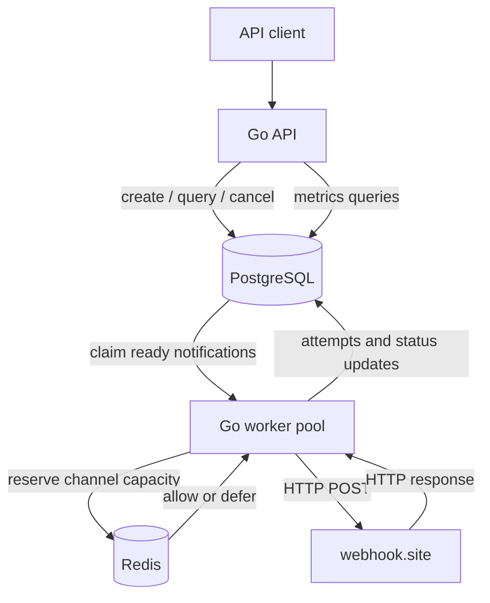

# Architecture

## Processing

1. The API validates the request and saves the notification in PostgreSQL
2. Workers claim eligible notifications by priority using `FOR UPDATE SKIP LOCKED`
3. A claim has a worker ID, a UUID claim token and an expiring lease
4. Redis enforces a shared rolling limit of 100 admissions per second for each channel
5. A worker records the delivery attempt and sends the request to webhook.site
6. The response updates the notification and its delivery-attempt record in one transaction
7. Failed or uncertain attempts are retried with bounded backoff when attempts remain
8. Lease heartbeats and recovery handle slow or interrupted workers

A Redis denial defers the claim without consuming a delivery attempt

## Data

- `notifications` stores request data, priority, state, attempts, schedule and claim ownership
- `batches` groups notifications created together
- `delivery_attempts` stores each provider attempt and its outcome
- `idempotency_keys` stores request fingerprints and their original results

The HTTP API and worker use the same PostgreSQL database but run as separate processes. Multiple worker instances can share the database and Redis limiter

## Delivery semantics

`accepted` means the simulated provider returned a valid HTTP 202 acceptance. It does not mean a real SMS, email or push message reached a device

The system uses at-least-once delivery attempts. A timeout after the provider receives a request may result in another attempt. The sender includes the notification ID as an idempotency key, but external deduplication depends on the provider

## Operations

- `GET /healthz` checks that the API process is running
- `GET /readyz` checks PostgreSQL connectivity
- `GET /api/v1/metrics` reads queue counts and five-minute delivery statistics from PostgreSQL
- JSON logs use request IDs for HTTP requests and notification IDs for processing correlation
- PostgreSQL migrations run before the API and worker start in Docker Compose

Redis must be available to authorize a delivery. If it is unavailable, the worker defers the notification instead of sending it without a rate-limit check
